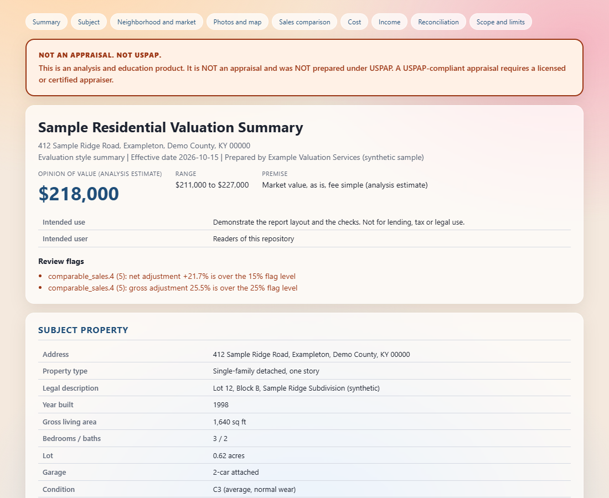
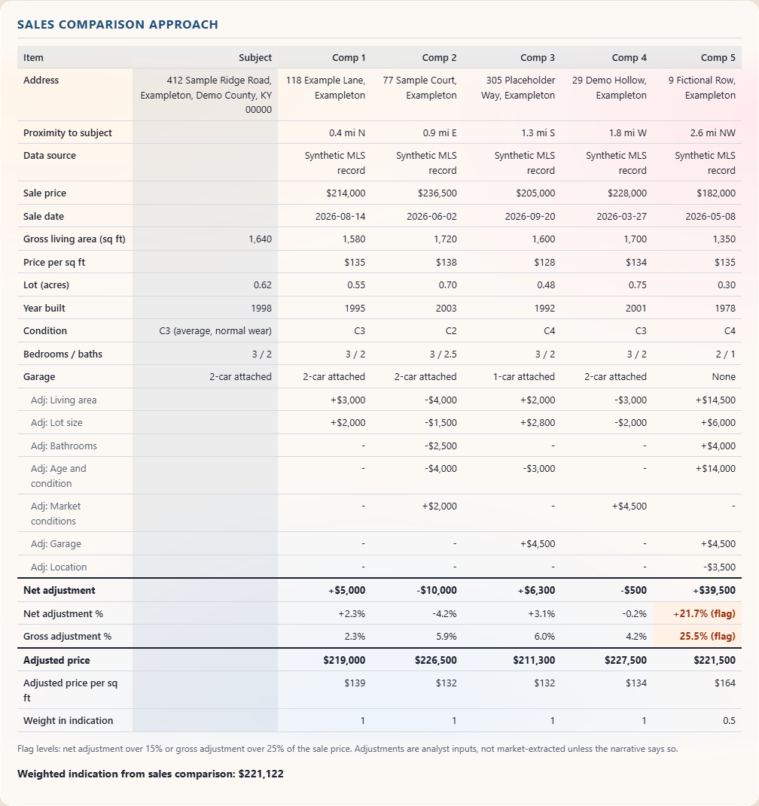

# valuation-report-builder

[](https://github.com/chasebuilds/valuation-report-builder/actions/workflows/ci.yml)
[](LICENSE)

**Turn one YAML or JSON file into a clean property valuation summary (HTML and PDF), and stop
with plain errors when the comps or the math do not hold up.**

[**Live demo**](https://chasebuilds.github.io/valuation-report-builder/) | [Sample PDF](examples/sample_report.pdf) (5 pages, synthetic data) | [Benchmark](BENCHMARK.md)



Good for: appraisal and brokerage offices that want consistent reports and fewer arithmetic
mistakes, and county offices that want a checked, readable summary from a spreadsheet of comps.

> **Not an appraisal.** This is an analysis and education tool. It does not produce a USPAP
> appraisal, and it does not copy any Fannie Mae or Freddie Mac form. A USPAP-compliant appraisal
> requires a licensed or certified appraiser. Every report this tool writes says so on the first
> page, in the footer of every PDF page, and in the limiting conditions.

New in 0.2: load comps from a spreadsheet CSV, export the computed numbers as JSON, and a warning
when comp adjusted prices spread too far apart.

## What it makes

An evaluation or broker price opinion style summary with:

- subject, site and improvements
- neighborhood and market conditions
- photos (local files, embedded in the output) and a map placeholder or your own map image
- sales comparison grid with adjustments, net and gross percent, and flags
- optional cost approach and optional income approach (gross rent multiplier)
- reconciliation with weights, opinion of value and range
- scope of work, assumptions and limiting conditions
- a prominent "not a USPAP appraisal" statement



The HTML is one self-contained file. On screen it uses a soft frosted-glass look. When printed
or saved to PDF it switches to a plain white layout.

## Use it

```powershell
py -m venv .venv
.venv\Scripts\python -m pip install -e ".[dev]"
.venv\Scripts\python -m playwright install chromium   # or use installed Edge/Chrome, see below
.venv\Scripts\python -m valuation_report.cli validate examples/sample_property.yaml
.venv\Scripts\python -m valuation_report.cli build examples/sample_property.yaml --html out/report.html --pdf out/report.pdf
```

The same commands work as `valuation-report validate ...` and `valuation-report build ...` once installed.

Why Playwright and not WeasyPrint: WeasyPrint needs GTK libraries that do not install cleanly on
Windows. Playwright prints the PDF with Chromium and works on Windows and in CI. It tries
Playwright's Chromium first, then installed Edge, then Chrome. Pick one with `--browser msedge`
or the `VRB_BROWSER_CHANNEL` environment variable.

## Comps from a spreadsheet, results as JSON

Keep comps in Excel or Sheets, export CSV, and point the build at it. The CSV replaces
`comparable_sales` in the YAML. See [examples/comps.csv](examples/comps.csv).

```powershell
.venv\Scripts\python -m valuation_report.cli build examples/sample_property.yaml --comps-csv examples/comps.csv --html out/report.html --json out/results.json
```

- One row per comp. Columns use the field names (`id`, `address`, `sale_price`, `sale_date`, ...).
- Adjustments are `adj:<label>` columns, for example `adj:Living area`. Blank means none.
- Money may be written `$214,000`, and `(2500)` means -2500. A BOM from Excel is fine.
- Bad cells stop with the row and column, for example `row 3, column 'sale_price': 'abc' is not a number`.
- `--json` writes the opinion, range, indications, weights, each comp's net and gross adjustment,
  adjusted price and flags, and the warnings. Use it to feed a spreadsheet or another tool.

## Input

Copy [examples/sample_property.yaml](examples/sample_property.yaml) and change it. Sections:
`report`, `subject`, `site`, `improvements`, `neighborhood`, `market`, `scope_of_work`,
`comparable_sales`, `thresholds`, `cost_approach` (optional), `income_approach` (optional),
`reconciliation`, `photos`, `map_image`, `assumptions`, `limiting_conditions`.
Unknown fields are rejected so typos do not pass silently. Photo paths are relative to the input file.

## What the checks catch

Errors stop the build and nothing is written:

| Check | Example message |
|---|---|
| Fewer than 3 comps | `comparable_sales: at least 3 comparable sales are required, found 2` |
| Adjustments do not sum | `comparable_sales.0 (1): adjustments do not sum. Sale price $214,000 plus adjustments $5,000 is $219,000, but stated adjusted price is $230,000` |
| Duplicate comp id, sale after the effective date | `duplicate comp id '1'` |
| Cost or income stated value does not match its parts | `cost_approach: land plus depreciated improvements is $211,940, but stated indicated value is $300,000` |
| Selected GRM outside the rental comp range, fewer than 3 rental comps | `selected GRM 300.0 is outside the comp range 148.8 to 160.0` |
| Reconciliation weights do not sum to 1, or name an approach that is not in the file | `weights sum to 1.200, must sum to 1` |
| Opinion of value outside the indications (1% rounding allowed) or outside the stated range | `opinion_of_value: $260,000 is outside the indications ...` |
| Missing required field, wrong type, unknown field, missing photo file | `site: Field required` |

Warnings do not stop the build. They print in the terminal and in a "Review flags" box in the report:

- net adjustment over 15% or gross adjustment over 25% of a comp's sale price (change with `thresholds`)
- adjusted prices of the weighted comps spanning more than 15% of their median
- a comp sale more than 12 months before the effective date
- an opinion of value more than 3% away from the weighted value

## Tests

```powershell
.venv\Scripts\python -m pytest
.venv\Scripts\python -m ruff check .
.venv\Scripts\python -m mypy
```

54 tests: schema validation, every error and warning above, CSV import and JSON export, the adjustment, cost, income and
reconciliation math, a golden-file test on the sample HTML (`UPDATE_GOLDEN=1 pytest` rewrites it
after a deliberate template change), HTML escaping, the CLI, and a PDF render. CI runs ruff,
ruff format, mypy in strict mode and pytest on Python 3.11 and 3.13.

## LIMITATIONS

- **Not an appraisal and not USPAP.** No signed certification, no appraiser license, no form layout.
  A lender, court or tax office will not accept this as an appraisal.
- The sample property, sales, rents and prices are invented. They describe no real person, owner,
  address or sale. Do not read them as market data.
- The tool does the arithmetic and the checks. Adjustment amounts, land value, cost per sq ft, rent,
  GRM and weights are your inputs. It does not find comps, extract adjustments from the market,
  or judge whether a comp is a good one.
- The cost and income approaches are simple: replacement cost new less depreciation plus land, and
  monthly rent times a gross rent multiplier. There is no full income capitalization or DCF.
- No map is generated and no address is geocoded. Add your own image with `map_image`.
- Dollar math uses floating point and a $1 tolerance when comparing stated totals.
- PDF output needs a Chromium browser (Playwright's, Edge or Chrome). HTML needs nothing extra.

## License

MIT, copyright Chase Builds. See [LICENSE](LICENSE).

## More from Chase Builds

- **[housing-market-trends](https://github.com/chasebuilds/housing-market-trends)**: Monthly market metrics and a time-adjustment rate with a confidence band. ([live demo](https://chasebuilds.github.io/housing-market-trends/))
- **[assessment-ratio-study](https://github.com/chasebuilds/assessment-ratio-study)**: Regressivity, under-assessment and sales chasing caught in 30 of 30 seeded counties. ([live demo](https://chasebuilds.github.io/assessment-ratio-study/))
- **[cost-approach-calculator](https://github.com/chasebuilds/cost-approach-calculator)**: Replacement cost, depreciation and land value, with every step shown. ([live demo](https://chasebuilds.github.io/cost-approach-calculator/))

[All projects, sorted by industry](https://github.com/chasebuilds) · [chasebuilds.github.io](https://chasebuilds.github.io)
